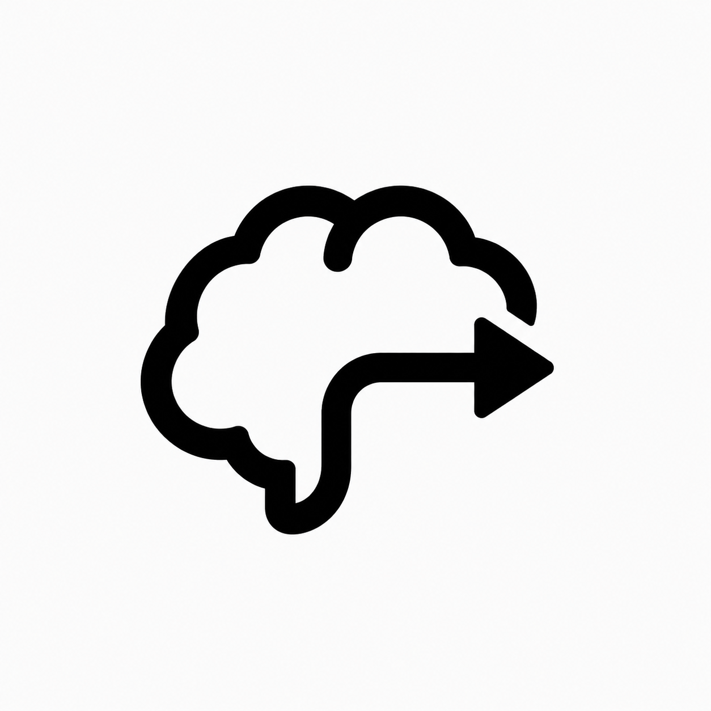

<div align="center">
  
  <h1>BrainExporter</h1>
  <p>Closer to the signal.</p>
  <p>An open-source Android workspace for EEG acquisition, live analysis and local export.</p>
  <p>
    <a href="https://github.com/vexpaer/BrainExporter/actions/workflows/android.yml"></a>
    <a href="LICENSE"></a>
    
  </p>
  <p><a href="https://github.com/vexpaer/BrainExporter/releases/latest"><strong>Download APK</strong></a> · <a href="docs/MODULES.md">Module guide</a> · <a href="https://github.com/vexpaer/BrainExporter/issues">Report an issue</a></p>
</div>

---

## Your signal. Your device.

Connect an RT-BCI / ADS1299 board over Bluetooth Low Energy. Inspect eight EEG channels, run signal processing and save timestamped CSV files directly to your phone.

- **Acquire** — Eight channels at approximately 250 Hz, with live sample-rate and packet-loss metrics.
- **Explore** — Waveforms, PSD, FFT spectra, EEG band power and electrode impedance estimates.
- **Extend** — Built-in processing and validated `.be-module.json` imports for EEG-to-EEG and EEG-to-features pipelines.
- **Keep it local** — Recordings stay on your device. No cloud EEG upload or analytics.

Native Kotlin. Jetpack Compose. A focused, dark Material 3 interface with **Home · Monitor · Modules · Settings**.

## Get started

1. Install the [latest APK](https://github.com/vexpaer/BrainExporter/releases/latest) on Android 8.0 or later.
2. Power on a compatible RT-BCI board and enable Bluetooth on your phone.
3. Open **Monitor → Scan for devices**, grant the requested permissions and select your board.
4. Choose **Start recording**, then **Stop recording** to finalize the CSV.

Recordings are saved in `Documents/eegData`. Android 8–9 requests storage permission when needed.

```text
BrainExporter_EEG_20260812_183000_000.csv
sample_index,packet_id,received_at_nanos,ch1_uv,...,ch8_uv
```

Supported BLE UART profiles: **FFF0 / FFF3 / FFF4** and **FFE0 / FFE1 / FFE2**. BrainExporter requires compatible acquisition hardware; a phone alone cannot measure EEG.

## Make it yours

Use **Modules** to enable built-in processing or import a validated manifest. View the output in Monitor alongside raw EEG. Imported manifests select supported engines and validated parameters; they do not execute external DEX or JAR files.

Read the [module guide](docs/MODULES.md) for contracts, examples and supported engines.

## Build from source

Requires **JDK 17+**, **Android SDK 36** and the Android SDK licenses accepted. Gradle is provided through the wrapper.

```bash
git clone https://github.com/vexpaer/BrainExporter.git
cd BrainExporter
./gradlew --no-daemon test lint assembleDebug
```

The debug APK is written to `app/build/outputs/apk/debug/`. Pull requests run the same checks in [GitHub Actions](https://github.com/vexpaer/BrainExporter/actions).

<details>
<summary>Project structure</summary>

| Module | Responsibility |
| --- | --- |
| `sdk-core` | Device, algorithm and processing contracts |
| `platform-ble-android` | Android BLE UART transport |
| `plugin-device-rtbci` | Packet parsing, scaling, commands and impedance |
| `plugin-algorithm-basic` | FFT, PSD, band power and processing engines |
| `core-runtime` | Sessions, data flow and module state |
| `plugin-ui-monitor` | Compose screens, charts and navigation |
| `app` | Assembly, Android permissions, CSV storage and updates |

</details>

## Research use & privacy

**Research prototype. Not a medical device.** Spectral features and impedance estimates are not diagnostic measurements. Validate packet loss, timing and calibration before a study.

ADS1299 impedance testing injects approximately **6 nA at 31.2 Hz** and is disabled during recording. With electrodes attached to a person, use battery power or a compliant isolated supply. Never connect worn electrodes to non-isolated USB on a mains-powered computer.

EEG files stay in `Documents/eegData`. Optional local accounts use salted PBKDF2-SHA256 password hashes. The app contacts GitHub to check for releases and supports downloading and installing updates from Settings.

## Contribute

Bug reports and focused pull requests are welcome. Include your Android version, board and BLE profile, reproduction steps, and logs with personal data removed. For code changes, read [AGENTS.md](AGENTS.md), preserve the device and module contracts, and run the checks above.

## License

[MIT](LICENSE) · Built by [Vexpaer](https://github.com/vexpaer).

Vendor firmware and third-party acquisition samples are not included.
